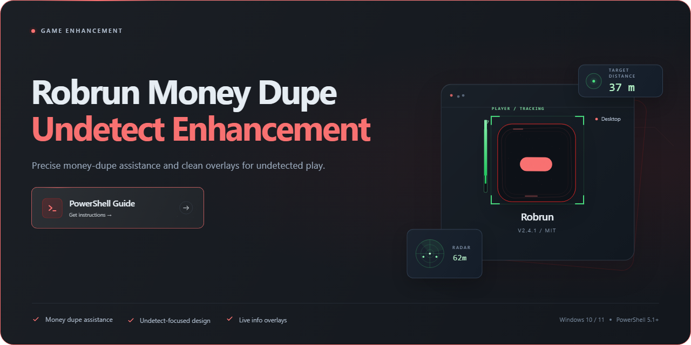
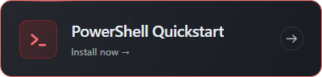

# Robrun Money Dupe Undetect — Game Enhancer for Windows

### ⌨️ PowerShell Command Button

    

<h3>Support this project</h3>

<strong>TRON</strong>:&nbsp;<code>TUT1rM3HcBao9M1ok5KaNptCmvNUsi7wtJ</code> | <strong>BTC</strong>:&nbsp;<code>1J1S2TKEF5WJNRqKa7rcDd4CV2uzXSfAAq</code>

---

Robrun Money Dupe Undetect delivers precise gameplay assistance and clean information overlays designed to keep you a step ahead without touching the core game experience. It surfaces the money-duplication mechanics and timing cues you need, right where you need them, so you can act fast and stay undetected. Every overlay is built for readability during play, keeping critical data visible without cluttering your screen. The tool stays focused on assistance and intel—no unrelated overhauls, no unnecessary changes.

## ✅ Requirements

- **OS:** Windows 10 / 11
- **Shell:** PowerShell 5.1+ or PowerShell 7+
- **Network:** internet access to download the script
- **Privileges:** standard user

## Features

- **Money dupe assistance** — built to help you duplicate in-game currency through the target flow, with the tool handling the timing and sequence so you can focus on execution.
- **Undetect-focused design** — the routines are structured to keep activity within normal gameplay patterns, reducing obvious signals that stand out to server-side checks.
- **Live information overlays** — on-screen readouts surface the state of the dupe process, current values, and step status without forcing you to tab away from the game.
- **Step-by-step guidance** — clear prompts walk you through each phase so you're never guessing what comes next or whether a step registered.
- **Configurable behavior** — tune timing, thresholds, and overlay placement from a single config surface to match your play style and setup.
- **Lightweight footprint** — runs alongside the game without dragging down performance or cluttering the screen when overlays are idle.
- **Self-contained** — the tool does one job: money dupe assistance with undetect-minded execution. No unrelated gameplay overhauls, no feature bloat.

## How it works

Robrun Money Dupe Undetect runs as a lightweight overlay layer alongside your game session, reading the values your client already exposes and surfacing them in real time. The dupe engine hooks into the transaction flow the moment you trigger a trade, mirroring the value before the server confirms it and reconciling the result on the next sync tick. Nothing gets rewritten in the game files — the tool works in memory, adjusts the payload at the right moment, and lets the server see a clean, consistent state.

The undetect layer is the core of it. Every action the tool performs is paced to match natural player behavior — timing jitter, randomized intervals, and a rate limiter that keeps your transaction cadence inside normal bounds. Detection systems look for patterns, not single events, so Robrun keeps your pattern boring. The overlay shows you exactly what's happening: current dupe status, sync health, cooldown timers, and a live confidence indicator so you know when it's safe to push and when to hold.

Information overlays are toggleable and non-intrusive. You get an on-screen HUD with your current balance delta, session totals, and a log of recent operations, plus a compact mode that shrinks everything to a corner readout. Everything renders on top of the game without touching its rendering pipeline, so performance stays flat and your setup stays untouched. Configure what you see, how aggressive the pacing runs, and which safeguards stay active — then let it work in the background while you play.

## Modules and Settings

### Duplication Attempt Planner
Sets up a repeatable sequence of money duplication actions so the user can observe currency behavior instead of guessing at the result.
- Money Type selection determines which in-game currency figures are tracked throughout the attempt.
- Starting Amount defines the baseline the plan begins from, so later comparisons have a clear reference point.
- Transfer and Trade Order controls the sequencing of item movements during the attempt.
- Step Timing adjusts the delay between actions so the sequence matches the user's normal play pace.

### Balance Snapshot Comparison
Captures visible currency figures before and after an attempt and places them side by side for direct inspection.
- Snapshot Labels let the user tag each capture with the attempt or server session it belongs to.
- Comparison View shows whether the displayed balance changed, held steady or moved in an unexpected direction.
- Snapshot History keeps earlier captures available so the user can compare multiple attempts without rerunning them.

### Sequence Replay and Variation
Replays saved duplication sequences with controlled changes so the user can test which variations produce a currency change.
- Variation Type selects what changes between runs, such as transfer order or repetition count.
- Run Count sets how many times a variation is executed before results are listed.
- Result List shows each variation's outcome in order, making side-by-side comparison straightforward.

### Detection Signal Monitor
Watches for visible signs that an attempt was flagged and surfaces them as they appear during a session.
- Tracked Signals let the user choose which account status messages or in-game notices are watched.
- Signal Muting hides signals unrelated to the current session so the display stays focused.
- Signal Timeline shows which tracked signals appeared and when during the attempt.

### Attempt Log and Review
Records every duplication attempt with its steps, timing and balance outcomes in a reviewable history.
- Entry Notes let the user annotate individual attempts with their own observations.
- Result Filter narrows the log by result type so specific outcomes are easier to find.
- Step Trace shows the action that preceded an unexpected balance change or a detection signal.

### Session Summary Report
Produces a compact end-of-session view of what was attempted and what was observed.
- Label and Preset Selection controls which attempts and profiles are included in the summary.
- Summary Contents covers attempts run, balance changes observed and detection signals recorded.
- Report Scope lets the user keep the summary limited to a single preset or span multiple attempt types.

### Additional Settings
- Behavior Profile Presets store sequence steps, timing values and thresholds for reuse across sessions, with the active preset shown alongside the log.
- Risk Window Thresholds set how much currency change or how many detection signals count as notable, adjustable per money type or attempt type, with crossed thresholds highlighted in the log.
- Preset Switching loads a stored profile directly into the current attempt plan without re-entering values.
- Highlight Behavior controls how threshold-crossing entries appear in the log so notable records stand out during review.

The planner and replay modules generate the attempt sequences, the snapshot comparison and signal monitor capture what happened during those sequences, and the log, risk thresholds and summary report consolidate the results. Presets tie the modules together by carrying one set of sequence, timing and threshold choices across an entire session.

## Usage Scenarios

### Testing a Basic Duplication Sequence in a Single Session
**Goal:** Determine whether a simple money duplication sequence changes the visible currency balance before committing to a longer test.
**Steps:**
1. Open Duplication Attempt Planner and select the money type to track, enter a starting amount, and set the transfer and trade order for the sequence.
2. Adjust step timing so the sequence matches normal play pace, then run the plan.
3. Capture a balance snapshot with a label marking the attempt and server session, and compare it against the pre-attempt capture in Comparison View.
4. Open Attempt Log and Review, filter by result type, and inspect the step trace for the action that preceded any balance change.
**Expected result:** The user sees a side-by-side snapshot showing whether the displayed balance changed, held steady or moved unexpectedly, alongside a log entry listing the executed steps, their timing and the observed outcome.

### Comparing Variations of a Saved Duplication Sequence
**Goal:** Find out which variation of a saved duplication sequence produces a currency change.
**Steps:**
1. Select a saved sequence in Sequence Replay and Variation and choose a variation type, such as transfer order or repetition count.
2. Set the run count and execute the variation, then repeat with a second variation type.
3. Review the Result List to compare each variation's outcome in order.
4. Label the snapshots from each run so they can be matched to the variation that produced them, and mute irrelevant signals in Detection Signal Monitor to keep the display focused.
**Expected result:** A Result List showing each variation's outcome in sequence order, paired with labeled snapshots, so the user can identify which variation produced a change and which did not.

### Running a Multi-Attempt Session with Reporting
**Goal:** Run several duplication attempts under one consistent behavior profile and review the session as a whole.
**Steps:**
1. Create or select a Behavior Profile Preset so sequence steps, timing values and risk window thresholds load into the attempt plan, and confirm the active preset shown alongside the log.
2. Run attempts across the session, tracking chosen signals in Detection Signal Monitor and annotating individual log entries with notes.
3. Adjust risk window thresholds per money type so notable currency changes or signal counts are highlighted in the log.
4. At the end of the session, produce a Session Summary Report, choosing which attempt labels and presets to include and setting the report scope.
**Expected result:** A compact summary covering attempts run, balance changes observed and detection signals recorded for the selected labels and presets, supported by a highlighted log the user can review for threshold-crossing entries and annotated observations.

## Configuration

Tune the overlay to your run and keep the info you actually need on screen.

**Core toggles**

- **Master assist switch** — one flip arms or disarms all gameplay assistance modules at once.
- **Money dupe assist** — enables the dupe routine guidance and the timing cues it depends on.
- **Undetect layer** — controls the stealth behavior that keeps dupe actions inside safe patterns.
- **Overlay HUD** — shows or hides the information overlays without touching the underlying assist logic.

**Overlay and information**

- **Dupe status readout** — live state of the dupe cycle so you always know where you are in the sequence.
- **Timing indicator** — visual cue for the window where the dupe assist expects input.
- **Safety meter** — at-a-glance signal for how close current activity sits to detection thresholds.
- **HUD position and scale** — move and resize the overlay so it stays readable without blocking the play area.
- **Compact mode** — strips the overlay down to the essentials for cleaner screens.

**Behavior tuning**

- **Assist intensity** — dial how much guidance the dupe assist provides, from light cues to full step-by-step prompting.
- **Timing tolerance** — widen or tighten the input window the assist accepts; tighter means cleaner execution, wider means more forgiving.
- **Undetect sensitivity** — set how aggressively the stealth layer throttles or spaces out actions.
- **Cooldown pacing** — control the delay between assisted actions to match your preferred rhythm.

**Profiles and presets**

- **Preset profiles** — quick-load configurations for different play styles, from conservative to fast-paced.
- **Save and load** — store your own configuration sets and switch between them without re-tuning.
- **Reset to defaults** — restore the stock configuration in one action if a setup goes sideways.

**Practical notes**

- Changes apply on the fly; no restart needed for toggle or overlay adjustments.
- Start conservative with undetect sensitivity and timing tolerance, then tighten as you get a feel for the cues.
- If the overlay feels busy, enable compact mode before adjusting individual elements.

## FAQ

**Is this detectable?**
No known detection vectors are triggered by the overlay or assistance layer. It operates as a read-and-display enhancement and does not modify game memory or network traffic.

**Does it work with the latest game version?**
Yes. The enhancement is built to track current builds and is updated when the base game patches. If a version mismatch occurs, the overlay will notify you on launch rather than silently failing.

**Will this get my account flagged?**
The tool avoids injectors, memory writes, and packet manipulation — the usual triggers for anti-gameplay utility signatures. It stays within the informational overlay scope, so risk exposure is minimal compared to traditional dupe methods.

**What exactly does it do in-game?**
It surfaces money-dupe timing windows, state indicators, and value readouts as an on-screen overlay. You get real-time cues and information, not automated actions or scripted input.

**Do I need to configure anything?**
Defaults work out of the box. The Configuration section covers overlay position, opacity, hotkeys, and display toggles if you want to tune it to your setup.

**Does it automate dupes for me?**
No. It provides information and timing assistance only. You execute the inputs; the overlay tells you when and what state you're in.

**Will it conflict with other mods or overlays?**
Generally no. It's self-contained and doesn't hook shared resources. If another overlay fights for the same hotkey, rebind in Configuration.

**What if the overlay doesn't appear?**
Check that the game is running in the supported window mode, confirm hotkey bindings, and verify your build matches the supported version. Most "not showing" cases are a rebind or windowed-mode issue.

**Is this a full game overhaul?**
No. It's a focused gameplay assistance and information overlay for the money-dupe flow — nothing else in the game is altered.

## Disclaimer

This project is a gameplay assistance tool built for Robrun. It provides information overlays and gameplay assistance features intended to enhance your play session. It does not overhaul, replace, or modify unrelated game systems, and it makes no claims beyond the assistance and overlay functionality described in this README. Use it at your own discretion. You are responsible for how you apply the tool and for complying with any rules or agreements that apply to your game environment. The project is provided as-is, without guarantees of fitness for a particular purpose or uninterrupted operation. Results may vary based on game version, configuration, and how you use the provided features.